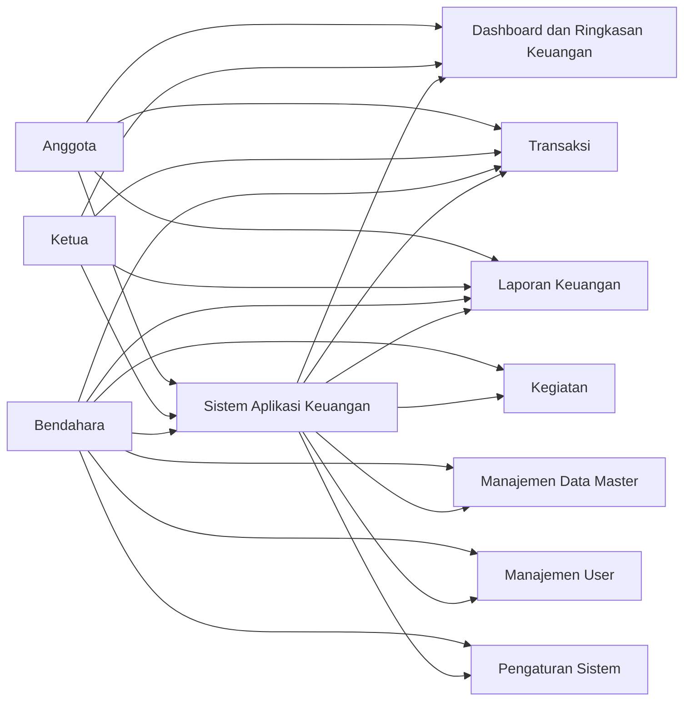
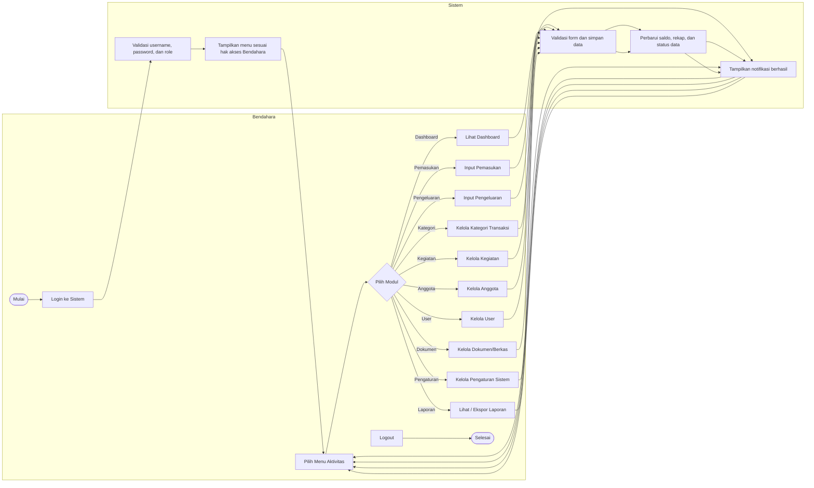
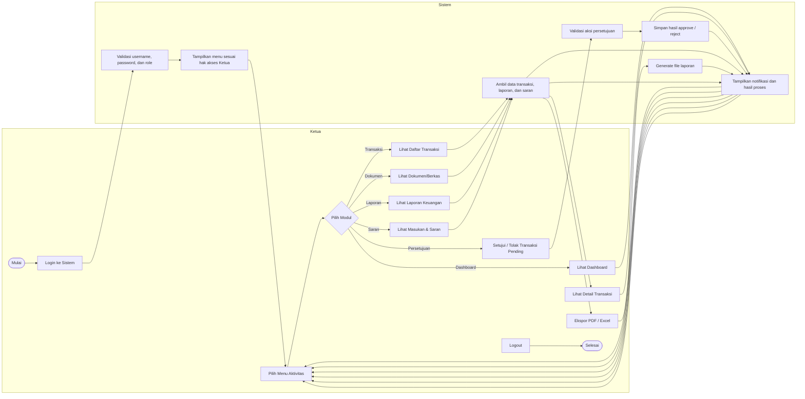
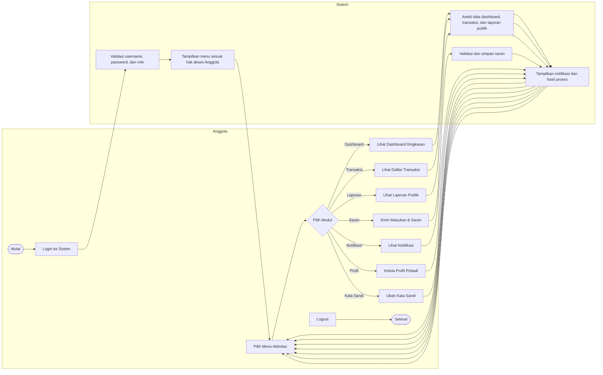
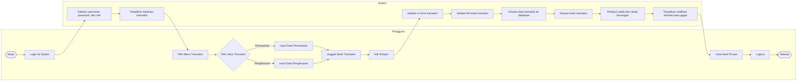

# Use Case Sistem Aplikasi Keuangan Karang Taruna 001 Lebak Bulus

## 1. Nama Use Case
**Mengelola dan Memantau Keuangan Organisasi Karang Taruna 001 Lebak Bulus**

Use case ini menggabungkan seluruh peran pengguna dalam satu alur utama. Setiap role memiliki hak akses berbeda, tetapi semuanya berinteraksi dengan sistem keuangan yang sama.

## 2. Aktor
- **Bendahara**
- **Ketua**
- **Anggota**

## 3. Tujuan
Menyediakan sistem keuangan organisasi yang transparan, akuntabel, dan mudah dipantau melalui pencatatan transaksi, pengelolaan data pendukung, visualisasi dashboard, dan laporan keuangan.

## 4. Deskripsi Singkat
Setelah login, sistem mengenali role pengguna dan menampilkan fitur sesuai hak aksesnya. Bendahara mengelola seluruh data operasional keuangan. Ketua memantau dan meninjau laporan. Anggota hanya melihat ringkasan dan informasi publik keuangan organisasi.

## 5. Pra-Kondisi
- Pengguna sudah memiliki akun yang aktif.
- Data master awal seperti kategori, kegiatan, dan pengaturan sistem tersedia.
- Pengguna berhasil login ke sistem.

## 6. Pasca-Kondisi
- Data transaksi, kegiatan, anggota, atau user tersimpan sesuai hak akses.
- Dashboard dan laporan menampilkan data terbaru.
- Saldo organisasi terbarui secara otomatis setelah transaksi diproses.

## 7. Alur Utama
1. Pengguna membuka sistem dan melakukan login.
2. Sistem memverifikasi username, password, dan status akun.
3. Sistem membaca role pengguna: Bendahara, Ketua, atau Anggota.
4. Sistem menampilkan menu dan fitur sesuai hak akses role tersebut.
5. Pengguna menjalankan fungsi yang diizinkan oleh role-nya.
6. Sistem memproses data, menyimpan perubahan, dan memperbarui informasi keuangan.
7. Sistem menampilkan hasil, notifikasi, dashboard, atau laporan sesuai kebutuhan pengguna.

## 8. Hak Akses Berdasarkan Role

| Fitur / Modul | Bendahara | Ketua | Anggota |
|---|---:|---:|---:|

\\\\

| Login & logout | Ya | Ya | Ya |
| Lihat dashboard | Ya | Ya | Ya |
| Lihat saldo dan grafik | Ya | Ya | Ya |
| Input pemasukan | Ya | Tidak | Tidak |
| Input pengeluaran | Ya | Tidak | Tidak |
| Edit / hapus transaksi | Ya | Tidak | Tidak |
| Upload bukti transaksi | Ya | Tidak | Tidak |
| Kelola kategori transaksi | Ya | Tidak | Tidak    |
| Kelola kegiatan | Ya | Tidak | Tidak |
| Kelola anggota | Ya | Tidak | Tidak |
| Kelola user & role | Ya | Tidak | Tidak |
| Lihat daftar transaksi | Ya | Ya | Ya |
| Lihat detail transaksi | Ya | Ya | Tidak |
| Lihat laporan keuangan | Ya | Ya | Ya, versi publik |
| Export PDF / Excel | Ya | Ya | Tidak |
| Pengaturan sistem | Ya | Tidak | Tidak |

## 9. Rincian Perilaku per Role

### 9.1 Bendahara
Bendahara adalah role utama dengan akses penuh. Role ini dapat menambah, mengubah, dan menghapus data transaksi, kegiatan, anggota, user, kategori, serta pengaturan sistem. Bendahara juga dapat mengunggah bukti transaksi dan mengekspor laporan.

### 9.2 Ketua
Ketua berfungsi sebagai role monitoring. Ketua hanya dapat melihat dashboard, transaksi, detail transaksi, dan laporan keuangan. Ketua dapat mengekspor laporan, tetapi tidak dapat mengubah data operasional.

### 9.3 Anggota
Anggota hanya memiliki akses baca untuk melihat kondisi keuangan organisasi secara umum. Anggota dapat melihat dashboard ringkasan, daftar transaksi, dan laporan publik, tetapi tidak dapat mengubah data apa pun.

## 10. Alur Alternatif
### A1. Login Gagal
- Jika username atau password salah, sistem menampilkan pesan gagal login.
- Pengguna diminta mencoba kembali.

### A2. Akses Tidak Sesuai Role
- Jika pengguna mencoba membuka fitur yang tidak sesuai role, sistem menolak akses.
- Sistem menampilkan pesan bahwa pengguna tidak memiliki hak akses.

### A3. Data Tidak Valid
- Jika form transaksi, kegiatan, atau anggota tidak valid, sistem menampilkan pesan validasi.
- Pengguna harus memperbaiki data sebelum disimpan.

## 11. Use Case Diagram Sederhana

## 12. Activity Diagram Per Role

> Diagram berikut disusun berdasarkan modul yang tersedia di sistem dan dibuat dengan format swimlane sederhana agar menyerupai contoh gambar yang kamu kirim.

### 12.1 Activity Diagram Bendahara

Aktivitas utama Bendahara:
1. Memantau Dashboard
2. Mengelola Transaksi Pemasukan
3. Mengelola Transaksi Pengeluaran
4. Mengelola Kategori Transaksi
5. Mengelola Kegiatan
6. Mengelola Anggota
7. Mengelola User
8. Mengelola Dokumen/Berkas
9. Mengelola Laporan Keuangan
10. Mengelola Pengaturan Sistem

### 12.2 Activity Diagram Ketua

Aktivitas utama Ketua:
1. Memantau Dashboard
2. Melihat Daftar Transaksi
3. Melihat Detail Transaksi
4. Memproses Persetujuan Transaksi
5. Melihat Dokumen/Berkas
6. Melihat Laporan Keuangan
7. Mengekspor Laporan PDF/Excel
8. Melihat Masukan & Saran
9. Logout

### 12.3 Activity Diagram Anggota

Aktivitas utama Anggota:
1. Memantau Dashboard Ringkasan
2. Melihat Daftar Transaksi
3. Melihat Laporan Publik
4. Mengirim Masukan & Saran
5. Melihat Notifikasi
6. Mengelola Profil Pribadi
7. Mengubah Kata Sandi
8. Logout

## 13. Activity Diagram Mengelola Data Transaksi Keuangan

Diagram ini menggambarkan alur umum pengelolaan data transaksi keuangan, baik pemasukan maupun pengeluaran, dari mulai input data sampai sistem memperbarui saldo dan menampilkan hasil.

## 14. Kesimpulan
Satu use case utama ini menunjukkan bahwa sistem berfokus pada pengelolaan dan pemantauan keuangan organisasi, dengan tiga role yang bekerja dalam satu sistem tetapi memiliki hak akses yang berbeda sesuai tanggung jawabnya.
